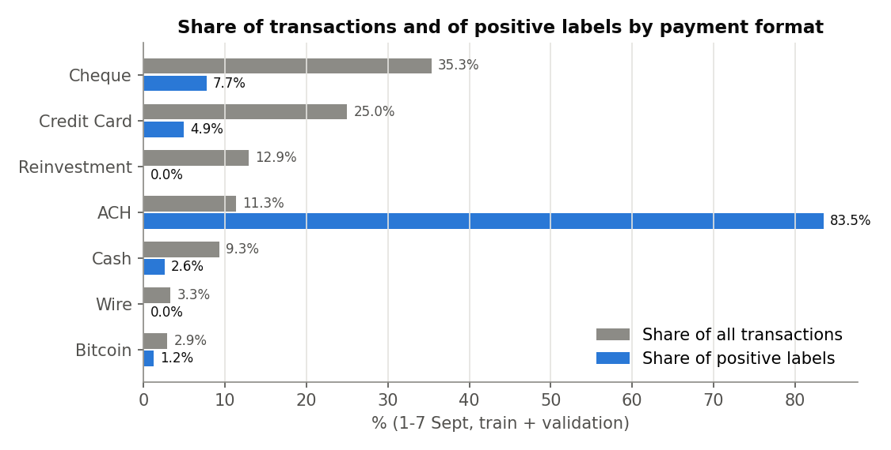
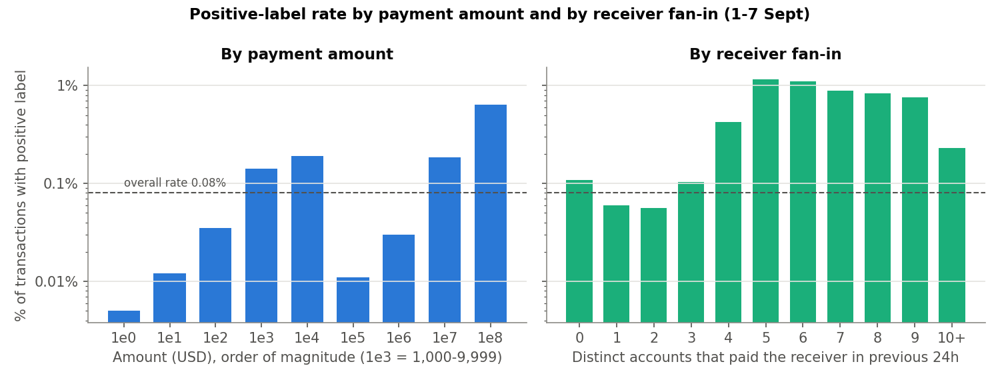
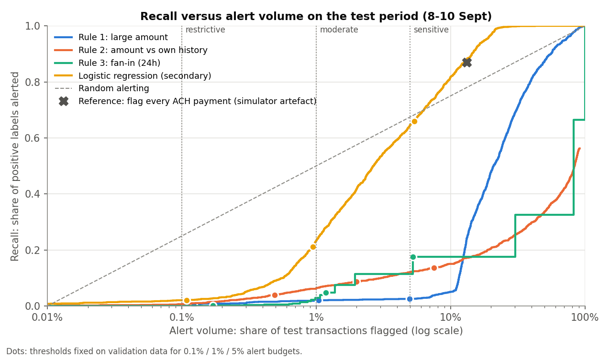
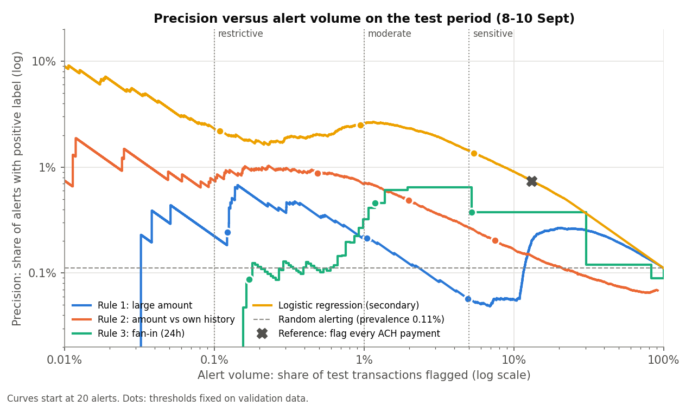

# Understanding False Positives in Transaction Monitoring

*An analysis of monitoring rules, alert thresholds and detection trade-offs
using PySpark and synthetic financial transactions.*

An independent, self-contained exploration of how simple transaction-monitoring
rules trade alert volume against detection, using IBM's synthetic AML
transaction data (HI-Small, about 5 million transactions) and PySpark. It is a
learning project, not a production-ready AML system.

## Motivation

I am a recent MSc Applied Data Science graduate with an interest in financial
crime detection. I work as a data analyst at Amsterdam UMC, where I build and
validate statistical and machine-learning models on clinical data. Transaction
monitoring raises a familiar model-evaluation problem: a rare outcome, strong
class imbalance, and a practical cost attached to every false alarm. It also
involves a domain and a tool that were new to me: anti-money laundering and
PySpark.

This project explores one concrete question in that area using careful
validation design, transparent metrics and cautious interpretation. It does not
model any bank's monitoring system; the rules below are my own illustrative
choices.

## Research question

**How do simple transaction-monitoring rules affect the number and quality of
alerts, and what trade-offs arise when trying to identify suspicious
activity?**

1. Which transaction characteristics and account behaviours are associated with
   the simulated suspicious-activity label?
2. How many alerts do simple rules generate, what share of them carry a positive
   label, and how many labelled transactions do they miss?
3. What happens when the rules are made more sensitive or more restrictive?
4. *(Secondary)* How does a plain logistic regression compare at the same
   alert volumes?

## Data

- **Source:** IBM, *Transactions for Anti Money Laundering*, file
  `HI-Small_Trans.csv` plus `HI-Small_Patterns.txt`, published on
  [Kaggle](https://www.kaggle.com/datasets/ealtman2019/ibm-transactions-for-anti-money-laundering-aml)
  (see also [github.com/IBM/AML-Data](https://github.com/IBM/AML-Data)).
  Licence: CDLA-Sharing-1.0. Described in Altman et al. (2023), *Realistic
  Synthetic Financial Transactions for Anti-Money Laundering Models*
  (NeurIPS Datasets & Benchmarks).
- **What it is:** transactions generated by a multi-agent simulation of
  individuals, companies and banks, some of whom launder money. "HI" means a
  relatively *higher illicit* ratio than the "LI" variants.
- **Columns:** timestamp (minute resolution), sending bank and account, receiving
  bank and account, amount received and its currency, amount paid and its
  currency, payment format (ACH, Cheque, Credit Card, Cash, Wire, Bitcoin,
  Reinvestment), and the label `Is Laundering`.
- **Size:** 5,078,345 transactions, 5,177 labelled positive (about 0.1%).
- **Labels are simulated.** A positive label means the simulator generated the
  transaction as part of laundering. It is not a confirmed real-world case. A
  negative label is just "not generated as laundering". In this README a
  *false positive* is an alert on a negative-label transaction: it is false
  relative to the simulated label, not proof the transaction would be harmless.

**A data issue I found and handled.** After 10 Sept 2022 the simulation
produces almost no ordinary transactions, but labelled laundering continues
(e.g. 11 Sept: 396 transactions, 232 labelled positive). Including those days
would make detection look artificially easy, so the analysis uses 1–10 Sept
only (5,077,237 transactions, 4,522 positive labels).

## Methods

**PySpark pipeline** ([`scripts/01_prepare_features.py`](scripts/01_prepare_features.py), [`src/tm/`](src/tm/))
- Read the CSV with an explicit schema. The header repeats `Account`.
  Identify accounts as `bank_account`, because account numbers are not unique
  across banks.
- Convert all amounts to USD. The file has no rate table, so one rate per
  currency is estimated as the median implied rate of cross-currency payments
  with USD, using the training period only.
- Compute account-history features with Spark window functions. Each window
  ends **one second before** the transaction, so neither the current
  transaction, nor other transactions in the same minute, nor anything later is
  used:
  - the sender's number of payments and distinct recipients in the previous 24h;
  - the sender's payments and average amount in the previous 7 days;
  - the receiver's number of distinct senders in the previous 24h (fan-in).

**Chronological split**

| Period | Days | Transactions | Positive labels | Rate |
|---|---|---|---|---|
| Train | 1–5 Sept | 2,766,832 | 1,999 | 0.072% |
| Validation | 6–7 Sept | 964,840 | 1,028 | 0.107% |
| Test | 8–10 Sept | 1,345,565 | 1,495 | 0.111% |

Exploration and rule design used train and validation only. Thresholds were
chosen on validation only. The test period was used once, for the final
comparison.

**Exploration with Spark SQL and DataFrames** ([`scripts/02_explore_with_spark.py`](scripts/02_explore_with_spark.py)):
covers class balance, payment formats, amounts, account activity, incoming
versus outgoing transfers and counterparty counts.

**Three transparent rules** ([`src/tm/rules.py`](src/tm/rules.py)). A rule
raises an alert when its score is at or above a threshold:

| Rule | Score | Idea |
|---|---|---|
| 1. Large amount | amount in USD | big payments deserve a look |
| 2. Amount vs own history | amount ÷ sender's mean payment in previous 7 days (needs ≥ 3 earlier payments) | unusual *for this account* |
| 3. Fan-in | distinct accounts that paid the receiver in previous 24h | many senders converging on one account |

Rule 3 was first defined as the larger of the sender's distinct recipients and
the receiver's distinct senders. When its thresholds were first set on the
validation period, they came out at thousands of counterparties per day, and the
restrictive setting caught no validation positives. The rule was effectively
flagging very busy accounts: the 99th percentile was about 9,000 recipients per
day for negative-label payments. A comparison on the training period confirmed
that the combined version caught no more labels than the sender part alone, while
receiver fan-in alone did better (4.6% vs 2.1% recall at a 1% alert budget).
Rule 3 therefore uses only fan-in (`results/tables/rule_design_train.csv`).
Because the change was prompted by validation results, Rule 3's validation-period
numbers are slightly optimistic. The test period was not used. The first
validation run was not kept as a result file.

**Sensitive vs restrictive.** Each rule gets three thresholds, chosen on the
validation days so that it flags at most **0.1% (restrictive), 1% (moderate)
or 5% (sensitive)** of transactions. Framing thresholds as an alert budget
makes the rules comparable with each other and with the model.

**Secondary: logistic regression** ([`src/tm/model.py`](src/tm/model.py)).
It uses the same history features plus log amount, payment format, and
cross-bank / cross-currency / self-transfer flags. Scaling and one-hot
encoding are fitted inside one scikit-learn pipeline on the training period.
It uses `class_weight="balanced"`, default `C=1`, and no tuning. Its thresholds
use the same validation alert budgets.

**Metrics** ([`src/tm/evaluation.py`](src/tm/evaluation.py)): alert count,
true and false positives, missed positives, precision, recall, F1,
false positives per true positive, lift over random alerting, and
precision-recall AUC (average precision).

## Results (test period, 8–10 Sept: 1,345,565 transactions, 1,495 positive labels)

### What distinguishes labelled transactions (train + validation)



- **Payment format dominates.** ACH is 11.3% of transactions but carries 83.5%
  of positive labels (positive rate 0.60% vs 0.02–0.03% for other formats).
  Wire and Reinvestment have *no* positive labels. This is very likely a
  feature of how the simulator generates laundering, not a general fact about
  money laundering.
- **Positive labels are mid-sized, not huge.** Median 4,852 USD versus
  943 USD for negative labels. The positive rate is highest at 1,000–99,999 USD
  and drops sharply at 100,000–999,999 USD, where many large ordinary payments
  sit. It rises again only for the very few payments above 10 million USD.
- **Receiver fan-in is informative in a narrow band.** Receivers paid by
  5–9 distinct accounts in the previous 24h have a positive rate of
  0.76–1.17%, roughly 9–14× the base rate of 0.08%. Above 10 senders the rate falls again,
  because those are busy, ordinary-looking receivers.
- **Quiet senders matter.** 44.6% of positive-label transactions come from
  accounts with no payment in the previous 24h, against 21.0% of all
  transactions. 42% of positives come from senders with too little 7-day
  history for Rule 2 to apply at all.
- Accounts involved in at least one labelled transaction send many unlabelled
  payments too: only 0.84% of their outgoing payments are labelled. Labelled
  activity is embedded in otherwise normal-looking accounts.



### Alerts, hits and misses at three sensitivity settings

| Approach | Setting | Alerts | % flagged | True pos. | False pos. | Missed | Precision | Recall | FP per TP |
|---|---|---|---|---|---|---|---|---|---|
| Rule 1: large amount | restrictive | 1,652 | 0.12% | 4 | 1,648 | 1,491 | 0.24% | 0.3% | 412 |
| | moderate | 14,055 | 1.04% | 30 | 14,025 | 1,465 | 0.21% | 2.0% | 468 |
| | sensitive | 66,508 | 4.94% | 38 | 66,470 | 1,457 | 0.06% | 2.5% | 1,749 |
| Rule 2: amount vs history | restrictive | 6,597 | 0.49% | 58 | 6,539 | 1,437 | 0.88% | 3.9% | 113 |
| | moderate | 26,824 | 1.99% | 131 | 26,693 | 1,364 | 0.49% | 8.8% | 204 |
| | sensitive | 100,780 | 7.49% | 204 | 100,576 | 1,291 | 0.20% | 13.6% | 493 |
| Rule 3: fan-in | restrictive | 2,301 | 0.17% | 2 | 2,299 | 1,493 | 0.09% | 0.1% | 1,150 |
| | moderate | 15,884 | 1.18% | 73 | 15,811 | 1,422 | 0.46% | 4.9% | 217 |
| | sensitive | 70,458 | 5.24% | 264 | 70,194 | 1,231 | 0.37% | 17.7% | 266 |
| Any of the three rules | moderate | 51,895 | 3.86% | 224 | 51,671 | 1,271 | 0.43% | 15.0% | 231 |
| Logistic regression | restrictive | 1,464 | 0.11% | 32 | 1,432 | 1,463 | 2.19% | 2.1% | 45 |
| | moderate | 12,667 | 0.94% | 317 | 12,350 | 1,178 | 2.50% | 21.2% | 39 |
| | sensitive | 72,512 | 5.39% | 986 | 71,526 | 509 | 1.36% | 66.0% | 73 |
| *Random alerting* | *any* | | *x%* | | | | *0.11%* | *x%* | *≈ 900* |

**Alert budgets are equal on validation, not exactly on test.** Thresholds
were chosen so that every approach flags the same share of *validation*
transactions. On the test days the realised volumes differ, for example 1.99%
for Rule 2 vs 0.94% for the logistic regression at the moderate setting. Rule 2's
restrictive setting flagged 0.49% instead of 0.1%. These differences give the
rules *more* alerts than the model, so they do not explain the model's better
recall. Figure 3 compares all approaches at identical test volumes.

Precision-recall AUC (test, base rate 0.0011): Rule 1 0.0021, Rule 2 0.0017,
Rule 3 0.0016, logistic regression 0.0183. Full tables:
[`results/tables/`](results/tables/).





### Main observations

1. **Simple single-transaction rules barely beat random alerting.** At the
   moderate setting (thresholds aimed at 1%; on the test days they flagged
   1.0–2.0% of transactions) the three rules find 2–9% of labelled
   transactions, against 1–2% for random alerting at the same volume. More than 99% of their alerts are false positives
   relative to the label. That is 200–470 negative-label alerts for every labelled
   hit.
2. **More sensitive is not automatically better.** Moving Rule 1 from 1% to 5%
   of transactions quintuples the alerts (14,055 → 66,508) but adds only 8 true
   positives. Over that range it performs *worse* than random. Rule 3 gains
   most from extra sensitivity (4.9% → 17.7% recall), but at roughly 266
   false positives per hit.
3. **Combining rules adds alerts faster than detections.** Running all three
   at the moderate setting flags 3.9% of transactions, nearly four times the
   alert volume of one rule, and finds 15% of positives.
4. **Thresholds set on one period do not fix the alert volume on another.**
   Rule 2's "1%" threshold flagged 2.9% of transactions on 9 Sept, a
   high-volume day. Rule 3 flagged 2.4% on Saturday 10 Sept, where it flagged
   0.9–1.0% on the validation days
   (`results/tables/daily_alert_rate_moderate.csv`). The restrictive Rule 2
   threshold produced 5× its intended alert volume on the test period.
5. **The logistic regression ranks much better (secondary).** At ~1% of
   transactions it finds 21% of positives with 39 false positives per hit.
   But its strongest coefficients are payment format (ACH +5.4,
   Reinvestment −6.0). Flagging *every* ACH payment would alone reach 86.9%
   recall at 13.2% alert volume (precision 0.73%). Much of the model's
   advantage therefore comes from a simulator artefact, not from behaviour
   that would carry over to real data.
6. **Many labels are invisible to per-transaction rules.** Much of the
   laundering in this dataset is generated as multi-step patterns (fan-out,
   cycles, scatter-gather, …). Across all simulated patterns the three rules catch at
   most about a fifth of the labelled transactions at the moderate setting.
   39% of test positives are not described in the patterns file at all
   (`results/tables/test_recall_by_typology.csv`).

## Why false positives matter, and why they are hard to reduce

Each alert in a monitoring process normally has to be reviewed by an analyst.
In this experiment, even the best rule produces one labelled hit per ~110–500
reviewed alerts. Investigators' attention is limited, so a rule that floods
the queue can *reduce* the chance that genuinely suspicious activity is
examined carefully. On the other hand, raising thresholds to cut false
positives quickly loses the few labelled cases the rules do catch.

The data suggests why this trade-off is hard with simple rules:
- the behaviour each rule looks for (large amounts, unusual amounts, many
  counterparties) is much more common among ordinary accounts than among
  labelled ones: busy accounts dominate high counts and large amounts;
- labelled transactions often look ordinary *individually*: mid-sized amounts,
  quiet senders, normal accounts that also send normal payments. Their
  suspicious character lies in the pattern they form with other transactions;
- alert volume depends on the calendar (weekdays, weekends, high-volume
  days), so a threshold calibrated on one week may overload or under-use
  analysts in another.

I do not attach costs or investigator hours to these numbers: I have no basis
for real operational figures.

## Limitations

- **Synthetic data, simulated labels.** Results describe the simulator's
  behaviour, not real customers, banks or criminals. Strong signals such as
  ACH-only laundering and the absence of laundering in Wire payments are
  probably artefacts.
- **Good results here would not transfer.** Real monitoring has
  delayed, incomplete and noisy labels (alerts → investigations → reports),
  adaptive offenders, customer and product context (KYC data, expected
  activity, business type), and regulatory requirements. None of these is in
  this dataset.
- **Short time span.** Ten usable days, with a three-day test period that
  includes one unusual high-volume day and one weekend day. The 7-day history
  is truncated at the start of the data, which affects the early training days.
- **Exchange rates** are estimated from the data, one fixed rate per currency.
- **Transaction-level evaluation.** Real systems often alert on accounts or
  customers over a period. Account-level aggregation would change the counts.
- **Rule 3 was redesigned once**, prompted by validation results and
  confirmed on training data (documented above). The test period was not
  involved.
- **The model is a baseline only:** no tuning, no probability calibration, one
  model family.

What would be needed in practice: domain expertise from AML investigators to
define meaningful scenarios, knowledge of customer segments and expected
behaviour, network (graph) features that link transactions into patterns,
feedback from investigated alerts, and monitoring of alert volumes over time.

## Reproducing

Requirements: Python 3.13 (tested) and Java 17 (needed by Spark).

```powershell
git clone https://github.com/Hariszss/aml-transaction-monitoring.git
cd aml-transaction-monitoring
python -m venv .venv
.venv\Scripts\activate
pip install -r requirements.txt
$env:JAVA_HOME = "C:\path\to\jdk-17"      # macOS/Linux: export JAVA_HOME=...
python run_all.py                         # ~15 minutes on a laptop (8 cores, 16 GB)
python -m pytest                          # 23 tests
python review/verify_reported_metrics.py  # independent check of the reported numbers
```

`run_all.py` runs `scripts/00`–`05` in order. Step 00 downloads the two
HI-Small files from Kaggle. If that fails, download `HI-Small_Trans.csv` and
`HI-Small_Patterns.txt` manually from the Kaggle page above and put them in
`data/raw/`.

Platform notes: developed on Windows 11 with PySpark 4.0.1 and Temurin JDK 17.
Spark's Python worker processes crashed in this Windows + Python 3.13
setup, so the pipeline uses only built-in Spark functions (no Python UDFs) and the tests
build Spark DataFrames from pandas through Arrow. Spark never writes files, so
`winutils.exe` is not needed.

```
├── run_all.py                  runs the whole analysis
├── scripts/
│   ├── 00_download_data.py
│   ├── 01_prepare_features.py  PySpark: load, clean, USD, window features
│   ├── 02_explore_with_spark.py  Spark SQL exploration, figures 1-2
│   ├── 03_rule_thresholds.py   rule design check (train), thresholds (validation)
│   ├── 04_logistic_regression.py  secondary baseline
│   └── 05_compare_on_test.py   final comparison, figures 3-4
├── src/tm/                     load, features, rules, evaluation, model, patterns
├── tests/                      pytest: cleaning, leakage-free windows, metrics, thresholds
├── results/tables/             all numbers quoted above (CSV)
├── figures/
├── review/                     independent re-computation of the reported metrics
└── requirements.txt            direct dependencies (requirements-lock.txt: full environment)
```
